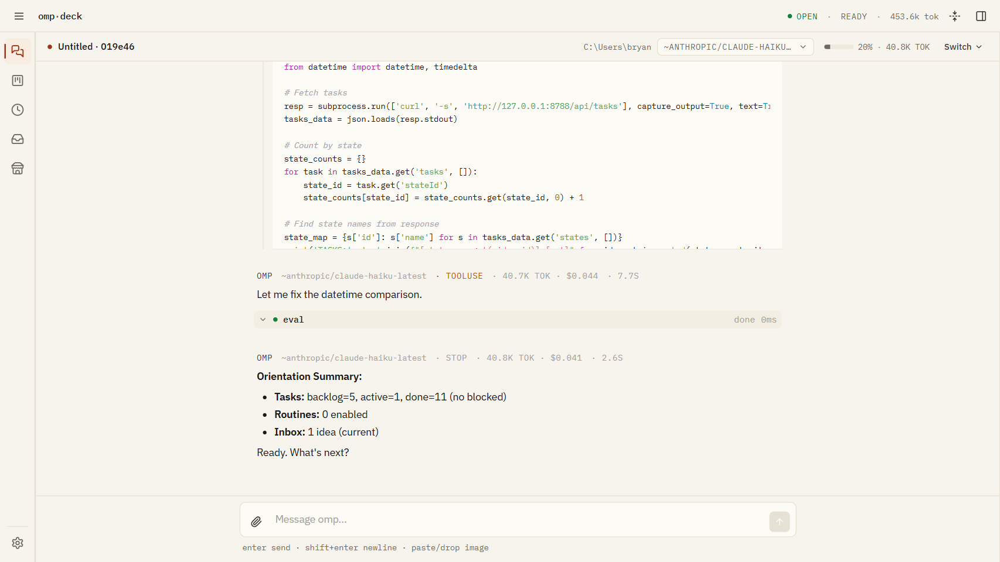
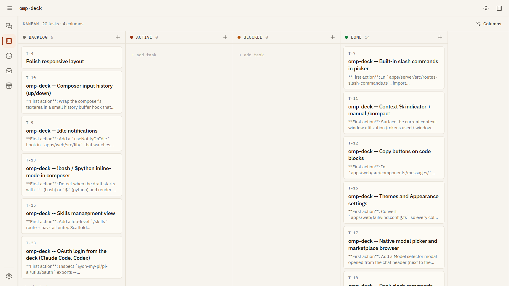
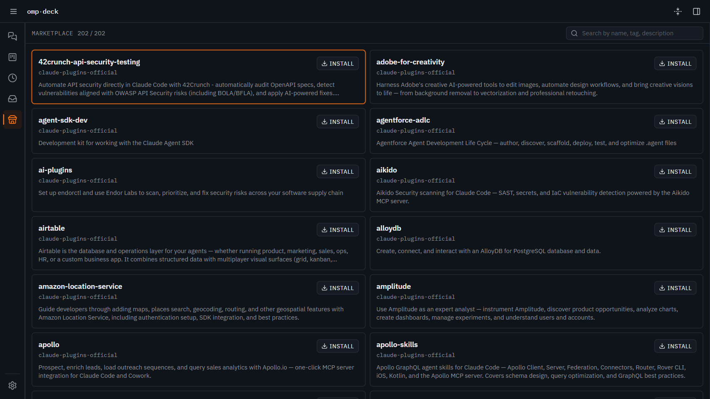
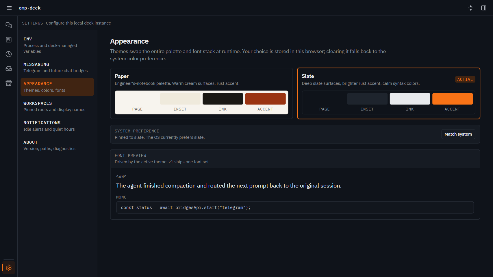
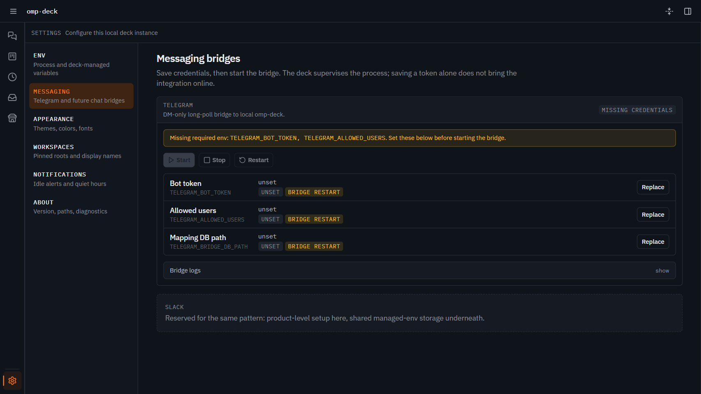
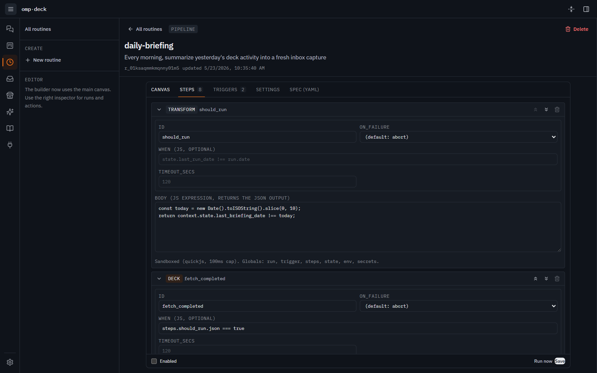
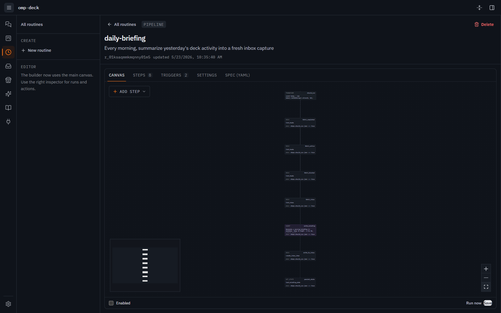

# NPI deck

**A calmer place to drive your coding agent.**

The [`omp`](https://github.com/can1357/oh-my-pi) terminal agent is excellent at the actual coding. But terminals weren't built for everything that comes with running an agent for hours a day: keeping track of what it's working on, glancing at it from another room, picking up where it left off tomorrow, deciding whether to let it execute the thing it just proposed.

NeoDeck is [NeoPi](https://github.com/PsychedelicShayna/neopi)'s orchestration and integration frontend for cards, routines, inbox, and messaging; [NeoCode](https://github.com/PsychedelicShayna/neocode) is its graphical frontend.

> **Status:** v0.5.0 — cross-platform CI matrix, Linux container builds and boots, Mac/Linux launcher. See [CHANGELOG.md](./CHANGELOG.md).



<details>
<summary>More screenshots</summary>

| | |
|---|---|
|  |  |
| Kanban with `T-N` display IDs (paper theme) | Marketplace browser populated with `anthropics/claude-plugins-official` (slate theme) |
|  |  |
| Settings → Appearance theme cards | Settings → Messaging with the Telegram bridge supervisor |
|  |  |
| V1 routines builder editing `daily-briefing` in form mode | The same routine in canvas mode — every step is a node |

</details>

## Who this is for

You're already running an agent. You've felt the friction of trying to:

- **Track what it's actually doing for you** as a body of work, not a scroll of terminal output that ends at `Ctrl+L`.
- **Ask it something from somewhere that isn't your laptop** such as the couch, a walk, bed.
- **Decide carefully** when it's about to do something big, instead of trusting it on the first try.
- **Capture an idea or a bug** without breaking your current focus.
- **Have it remember things** across sessions without you stuffing context windows by hand.

NPI deck is the cockpit that holds all of that. The chat surface stays at parity with the terminal,  but everything *around* the chat is built for the rest of the work.

## What you get

**A kanban that's actually yours.** Backlog → Active → Done columns with drag-and-drop. Tasks get `T-N` display IDs you can refer to in conversation (`/task done T-32`). Assign an agent directly from a card: it starts automatically, queues behind the configurable global limit (12 by default), and reports its outcome on the card. Each run gets a temporary git worktree that is removed afterward, unless leading YAML links an existing `worktree`. Set `read-only: true` for mechanically restricted research; linked worktrees are never removed. UI, chat, inbox/capture promotion, API, routines and messaging bridges preserve arbitrary leading YAML properties; [configuration](docs/configuration.md#card-agents) documents execution and routing.

**Plan mode** — Shift+Tab in the composer enters NeoPi's read-only planning mode. The agent writes a `local://<slug>-plan.md` artifact and submits it through `xd://propose`; the plan appears in the chat for approval, in-place editing, or rejection with feedback. Approval returns the agent to full tools to execute; rejection lets it revise and resubmit. A resumed planning session restores its plan artifact.

**An inbox you can dump into.** Scratch ideas, bug reports, decisions to revisit. One-click promote to task when the dust settles. No mental context-switch from current work.

**A knowledge base over your own markdown.** Point `/kb` at your vault for a read-only tree, viewer, Obsidian-style graph, links/backlinks and search. Agents traverse with `kb_read` and populate server-scoped project knowledge with `kb_write`. No KB content enters a prompt automatically: use `/kb read <path>` in chat, explicitly wire routine inputs, or tell the agent to consult a section. Capture an inbox item with `/kb capture <inbox-id> projects/<project>/<note>.md` in a project chat.

**Routines.** Multi-step pipelines on a cron, webhook, manual, or event trigger — author them visually on a node canvas, or in YAML if you're that kind of person. Ships with a `daily-briefing` template that wakes up, reads your kanban + inbox, and writes you a one-card morning summary back to the inbox. Build your own from there.

**A messaging bridge to your phone.** Telegram now (Slack / Discord / Matrix on the roadmap). DM the agent from anywhere; replies stream live via `editMessageText`. Allowlist-gated so only you (and whoever you invite) can drive it.

**Multi-session.** The chat sidebar lists every session you have open, plus the persisted ones you can resume. Each gets its own kanban scope, its own model, its own queued prompts. Switch between them without losing place.

**A marketplace.** Browse, install, and uninstall skills/plugins/MCPs over the SDK's plugin format. Empty state seeds with `anthropics/claude-plugins-official` so you're never staring at an empty page.

**Settings that respect your `.env`.** Provider API keys, host/port, data dirs — all manageable from a UI with masked secrets, an audit log, and atomic writes. Hot-applied where possible.

**Three themes.** Paper (warm cream + rust accent, engineer's-notebook aesthetic), Slate (dark), Horizon (purple-ink dark). FOUC-free swap — pick one and refresh-proof it.

## Quickstart

NPI deck lives under `deck/` in the NeoPi repository. Install dependencies at
the repository root, stage a matching native addon, and select this checkout
as the runtime backend:

```sh
git clone https://github.com/PsychedelicShayna/neopi.git
cd neopi
bun install --frozen-lockfile
bun deck/scripts/native-addon.ts --native-dir /path/to/matching-neopi-checkout
# Or after ./build.sh: bun deck/scripts/native-addon.ts --built
NPI_DECK_BACKEND="$PWD" bun --cwd=deck run dev
```

For a supervised server, build with `bun --cwd=deck/apps/web run build`, then
run `NPI_DECK_BACKEND="$PWD" deck/bin/npi-deck`. Existing state, services and
backend selection are untouched until you switch them yourself.
See [the install guide](./docs/install.md) for prerequisites and backend checks.

On first run, the deck creates `~/.omp/agent/` from scratch; its own state lives in `~/.npi-deck/` (override with `NPI_DECK_HOME`). If you already use `omp` in a terminal on this machine, your existing `~/.omp/agent` is picked up automatically — no re-auth.

**Authenticate (one-time, in the deck UI):**

- **Claude Pro / Max, ChatGPT Plus / Pro, or any subscription provider** → Settings → Providers → click *Sign in*. Browser OAuth flow handles the rest. Token stored in `~/.omp/agent/auth.db`.
- **Anthropic / OpenAI / OpenRouter / Google / etc. API key** → Settings → Env → paste the key. Saved to the deck-managed `.env` (never logged in clear text).

That's it — pick a model in the chat surface and send a prompt.

Other environment settings include `NPI_DECK_PORT`, `NPI_DECK_HOST`, `NPI_DECK_DB_PATH` and `NPI_DECK_UPLOADS_ROOT`. See [configuration](./docs/configuration.md) and [installation](./docs/install.md).

## Releases

NeoDeck follows NeoPi's repository and release process. Its Ubuntu CI job
typechecks all four deck workspaces and builds the web application. Compiler
and web-build failures fail the job. Deck tests report counts and failing names
without blocking it. Native addons come from NeoPi's existing CI artifact.

Old standalone checkout archives describe the pre-subtree layout and are not
an installation path for this tree.

## How it compares

omp + NPI deck is one slice of a busy space. The neighbors:

|                                | **omp + NPI deck**                                                                | **[Claude Code](https://github.com/anthropics/claude-code)** | **[Hermes Agent](https://github.com/NousResearch/hermes-agent)** | **[OpenClaw](https://github.com/openclaw/openclaw)**                       |
|--------------------------------|-----------------------------------------------------------------------------------|--------------------------------------------------------------|------------------------------------------------------------------|----------------------------------------------------------------------------|
| Form factor                    | Terminal TUI (omp) + web cockpit (NPI deck)                                       | Terminal CLI / IDE plugin                                    | Terminal TUI + multi-channel gateway                             | Daemon + multi-channel gateway                                             |
| Model support                  | Anthropic, OpenAI, Google AI / Vertex, OpenRouter, Ollama, llama.cpp, LM Studio, any OpenAI-compatible | Anthropic Claude only                                        | Model-agnostic (Nous Portal, OpenRouter, NIM, …)                 | Model-agnostic (profiles in `openclaw.json`, w/ fallback chain)            |
| Hosting                        | Self-hosted Bun process, loopback-only by default                                 | Anthropic-hosted CLI                                         | Local / Docker / SSH / Modal / Daytona / Vercel Sandbox          | Self-hosted on owned host (Mac mini, VPS)                                  |
| Kanban / task board            | Built-in, WS-synced, `T-N` display IDs                                            | —                                                            | —                                                                | —                                                                          |
| Plan mode                      | Shift+Tab / `/plan` → propose → approve/edit/reject before execution              | TUI plan-mode equivalent                                     | —                                                                | —                                                                          |
| Routines / scheduled work      | Multi-step pipelines + visual canvas + per-step observability                     | —                                                            | —                                                                | Heartbeat scheduler (~30 min)                                              |
| Knowledge base                 | `/kb` cockpit over local markdown wiki + graph + backlinks                        | —                                                            | "Deepening user model" (internal, not a markdown wiki)           | —                                                                          |
| Inbox + promote-to-task        | Built-in                                                                          | —                                                            | —                                                                | —                                                                          |
| Messenger bridges              | Telegram (Slack / Discord / Matrix on the roadmap)                                | —                                                            | Telegram, Discord, Slack, WhatsApp, Signal                       | 20+ (WhatsApp, Telegram, Slack, Discord, iMessage, Matrix, Teams, …)       |
| License                        | MIT                                                                               | Proprietary                                                  | Open source                                                      | Open source                                                                |

The short version: **Claude Code** is the polished vendor experience for Claude. **Hermes** is the self-improving agent with serverless backends. **OpenClaw** lives wherever you message from. **omp + NPI deck** is the cockpit shape — a model-agnostic coding agent with a web surface for the work *around* the chat (kanban, routines, KB, inbox, plan-mode approval, messaging bridge).

## A few notes on running it

**It's not a hosted product.** You run it yourself, on your machine or in a VM you own. Defaults are loopback-only — to reach it from your phone, front it with Tailscale Serve, an SSH tunnel, or a reverse proxy with its own auth. See [docs/deployment.md](./docs/deployment.md) for the hardening checklist.

**It's not a replacement for `omp`.** It embeds the same SDK in-process and shares the same `~/.omp/agent` session + auth store. Run both — they coexist. The terminal is still where you'll do quick one-shots; the deck is where work sticks around.

**State is yours.** Tasks, inbox, routines, KB — all SQLite + plain markdown on disk. No telemetry. The deck never logs secret values, only redacted forms.

## Docs

- [Install](./docs/install.md) covers native addons, `config.yml` and the `npi-deck` launcher.
- [Configuration](./docs/configuration.md) — full env reference + restart semantics.
- [Deployment](./docs/deployment.md) — Tailscale, SSH-tunnel, hardening checklist.
- [Slash commands](./docs/slash-commands.md) — deck `/task` + `/plan`, SDK builtins, user/project markdown commands.
- [Marketplaces](./docs/marketplaces.md) — catalog seeding, install semantics, capability badges.
- [Skills](./docs/skills.md) — `/skills` view, plugin → skill hierarchy, scope semantics, REST surface.
- [Telegram bridge](./docs/telegram.md) — DM-driven agent from your phone.
- [Themes](./docs/themes.md) — Paper / Slate / Horizon / adding more.
- [Architecture](./docs/architecture.md) — workspace layout, frame model, synthetic events, theming.
- [TUI parity](./docs/tui-parity.md) — feature matrix vs the omp TUI.
- [Contributing](./CONTRIBUTING.md) — dev loop, code quality, style.

## License

MIT. See [LICENSE](./LICENSE). NPI deck is a fork of [Shreyans13/omp-deck](https://github.com/Shreyans13/omp-deck), originally by Bryan Bartley. The active upstream is `Shreyans13/omp-deck`; original `bjb2/omp-deck` credits record historical provenance. Branches, promotion, releases, and contribution workflow are documented in [Repository policy](./docs/agents/policy.md).
